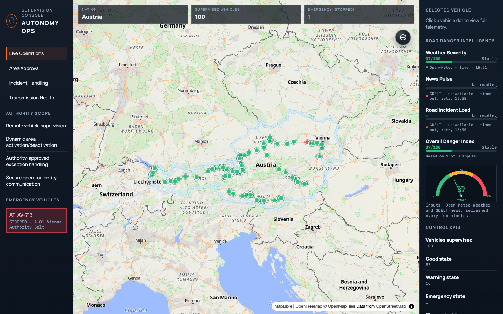
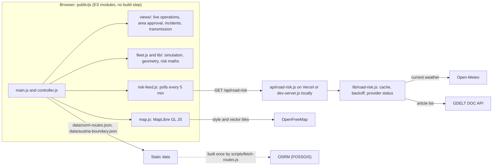

# Autonomy Ops Console

A browser-based supervision console for automated-driving trials in Austria: a simulated fleet on real roads, with a road-risk index built from live public weather and news data.

[](https://github.com/Brok3nnn/autonomy-ops-console/actions/workflows/ci.yml)
[](LICENSE)
[](package.json)

**Live demo:** https://autonomy-ops-console.vercel.app



## Overview

This is a **concept prototype**. The vehicles, their alerts and the infrastructure telemetry are simulated; the roads, the country boundary, the weather and the news are real public data. Nothing connects to a real vehicle.

Features:

- **Live Operations.** 100 simulated vehicles drive along 17 road corridors on real Austrian roads (MapLibre GL map with OpenFreeMap tiles). Each vehicle is Good, Warning or Emergency. A vehicle that enters Emergency stops and stays stopped until an operator resumes it from the emergency card; the card also logs 112 calls, roadside dispatch and fleet alerts.
- **Road danger index.** A gauge and three inputs (weather severity, news pulse, road incident load) from Open-Meteo and GDELT. Every input shows its provider status (live, cached or unavailable, with times) instead of a silent fallback number.
- **Area Approval.** Road segments coloured by operator decision and risk, with simulated hazard spans. Operators can block a segment; vehicles on it are rerouted over the remaining network.
- **Incident Handling.** One strip per vehicle with an expandable incident console.
- **Transmission Health.** Simulated relay nodes with link telemetry, the units nearest to each node, and remote actions (power cycle, cache purge, traffic reroute).

## Architecture



The front end is plain HTML, CSS and native ES modules served from `public/`. Pure logic (geometry, routing, vehicle state, risk maths, signal generation) lives in DOM-free modules under `public/js/lib/` and is unit-tested in Node. The only server code is the road-risk feed in `lib/`, exposed as a Vercel function in `api/` and mounted by a small Express server for local runs. The same handler code runs in both places.

## How it works

### Road-risk feed

[`lib/road-risk.js`](lib/road-risk.js) turns two public sources into three 0–100 scores:

- **Weather** (Open-Meteo, current conditions in Vienna, Graz, Salzburg, Innsbruck, Klagenfurt and Linz). Per city:
  `clamp(8 + wind + wet + temperature + code, 0, 100)` where
  `wind = clamp((wind_speed_10m − 18) × 2.1, 0, 36)`,
  `wet = clamp((precipitation + 0.9 × rain + 1.3 × snowfall) × 12, 0, 36)`,
  `temperature` is 18 at ≤ −7 °C, 10 at ≤ −1 °C, 16 at ≥ 35 °C, 10 at ≥ 30 °C and 0 otherwise, and
  `code` maps the WMO weather code: clear 0, mainly clear 5, overcast or fog 12, drizzle or rain 18, freezing rain 28, snow 32, thunderstorm 40, other 10, missing 8.
  The weather score is the rounded mean over the six cities.
- **News** and **incidents** (GDELT, up to 50 articles for `austria (traffic OR road OR accident OR closure OR weather)`):
  `news = round(clamp(12 + 0.9 × articles + 1.2 × recent + 1.5 × weatherMentions, 8, 95))` and
  `incidents = round(clamp(10 + 3 × incidentMentions + 1.4 × recent, 8, 98))`,
  where `recent` counts articles seen in the last 72 hours and the mentions count titles containing weather or incident keywords (English plus a few German terms). An empty result scores 16 and 12.

The browser combines the available inputs in [`public/js/lib/risk.js`](public/js/lib/risk.js):

```
overall = round( Σ wᵢ × scoreᵢ / Σ wᵢ )   over the inputs that are available
weights: weather 0.34, news 0.28, incidents 0.38   (they sum to 1)
bands:   < 45 Stable, 45–74 Watch closely, ≥ 75 Emergency profile
```

When an input is unavailable, its weight drops out and the panel says so ("Based on 1 of 3 inputs"). The scores are heuristics for a demo, not a validated risk model.

### Reliability design

- **CDN caching.** `/api/road-risk` answers with `Cache-Control: public, s-maxage=600, stale-while-revalidate=3600`, so on Vercel the function runs at most about once per 10 minutes per region. The browser never forces a refresh; it polls the normal URL every 5 minutes ([`public/js/risk-feed.js`](public/js/risk-feed.js)).
- **Per-provider cache.** Each provider keeps its last value in memory with its own refresh interval (Open-Meteo 10 min, GDELT 15 min). Concurrent requests share one upstream call.
- **Short timeouts.** Each upstream request, body included, is aborted after 2.5 s. Both providers run in parallel, so the endpoint answers in about 2.5 s even when an upstream hangs.
- **Backoff.** After a failure a provider is not called again for 1, 2, 4 … up to 30 minutes. A `429` or `503` with `Retry-After` (seconds or HTTP date) waits at least that long. GDELT's plain-text rate-limit notice, which sometimes arrives with HTTP 200, counts as a rate limit.
- **Degraded states.** A provider is `live` (value within its refresh interval), `cached` (refresh failed or backing off; last good value, at most 6 hours old) or `unavailable`. Every provider entry carries `updatedAt`, `checkedAt`, `retryAt` and an `error` code (`timeout`, `rate-limited`, `network-error`, `invalid-response`, `http-<status>`). GDELT often refuses or times out from shared cloud IPs, so "unavailable" is an expected state, and the UI shows it with the reason and the retry time.

Example payload:

```json
{
  "generatedAt": "2026-11-26T14:51:43.723Z",
  "signals": {
    "weather": { "score": 37, "provider": "openMeteo" },
    "news": { "score": null, "provider": "gdelt" },
    "incidents": { "score": null, "provider": "gdelt" }
  },
  "providers": {
    "openMeteo": {
      "name": "Open-Meteo",
      "status": "live",
      "updatedAt": "2026-11-26T14:51:41.293Z",
      "checkedAt": "2026-11-26T14:51:41.163Z",
      "retryAt": null,
      "error": null
    },
    "gdelt": {
      "name": "GDELT",
      "status": "unavailable",
      "updatedAt": null,
      "checkedAt": "2026-11-26T14:51:41.220Z",
      "retryAt": "2026-11-26T14:52:43.723Z",
      "error": "timeout"
    }
  }
}
```

### Road network and fleet

- [`public/js/config.js`](public/js/config.js) defines 33 city nodes and 17 corridors. Their geometry comes from `public/data/osrm-routes.json`, a cache built once with [`scripts/fetch-routes.js`](scripts/fetch-routes.js). The app never calls a routing server.
- [`public/js/lib/corridors.js`](public/js/lib/corridors.js) checks each route against the Austria boundary, splits corridors where they pass other cities (so the network has junctions) and runs Dijkstra for detours when an operator blocks a segment.
- [`public/js/lib/vehicle-state.js`](public/js/lib/vehicle-state.js) holds the vehicle state machine: health from corridor status and telemetry alert, the emergency latch, and the operator release.
- [`public/js/lib/authority.js`](public/js/lib/authority.js) generates the Area Approval hazard signals. They are simulated but deterministic: a string hash of the corridor id and the current 15-minute bucket fixes their position, age and text, so the map does not flicker between renders.

## Design decisions and trade-offs

- **No build step.** Native ES modules keep the repository deployable as static files plus two functions. The cost is about twenty small module requests on first load, which HTTP/2 handles well, and no TypeScript (JSDoc comments document the shapes instead).
- **Pre-computed routes.** The public OSRM servers allow at most one request per second and no heavy use. Shipping a route cache of about 870 KB avoids every visitor triggering routing requests, and makes start-up deterministic.
- **In-memory cache instead of a datastore.** Combined with CDN caching this needs no infrastructure. The trade-off is that a cold serverless instance starts without a last good value, so a provider that fails at that moment shows as unavailable.
- **Honest degraded states.** The panel never invents a reading. The simulated Area Approval signals still need numbers, so they use a neutral baseline for missing inputs; that baseline is never displayed as a reading.
- **One handler, two hosts.** The handlers in [`lib/http.js`](lib/http.js) use only Node's core request/response API, so Vercel and Express run identical code. The local server is called `dev-server.js` so that Vercel does not auto-detect an Express app.

## Tech stack

- HTML, CSS and JavaScript (ES modules), no framework, no bundler
- [MapLibre GL JS](https://maplibre.org/) 4.7.1 with [OpenFreeMap](https://openfreemap.org/) tiles
- Node.js (>= 20): Vercel serverless functions, [Express](https://expressjs.com/) 5 for local runs
- `node:test` for tests, ESLint 9 (flat config) and Prettier 3, GitHub Actions on Node 24

## Getting started

Requirements: Node.js 20 or newer and npm. No API keys are needed.

```bash
git clone https://github.com/Brok3nnn/autonomy-ops-console.git
cd autonomy-ops-console
npm ci
npm run dev
```

Open http://localhost:3000. `npm run dev` restarts the server when server files change; `npm start` runs it without watching.

### Deploy to Vercel

1. Push the repository to GitHub and import it in Vercel (or run `vercel deploy` with the [Vercel CLI](https://vercel.com/docs/cli)).
2. Keep the defaults: no framework is detected (preset "Other"), there is no build command, static files are served from `public/` and every file in `api/` becomes a function. If Vercel suggests a framework, choose "Other".
3. No environment variables are required.

## Configuration

| Setting | Where                | Default | Purpose                          |
| ------- | -------------------- | ------- | -------------------------------- |
| `PORT`  | environment variable | `3000`  | Port of the local Express server |

The feed's timeouts, refresh intervals, maximum staleness and backoff live in `DEFAULT_OPTIONS` in [`lib/road-risk.js`](lib/road-risk.js). There are no secrets, so the repository has no `.env.example`.

To rebuild the route cache (17 requests, one per 1.1 seconds, to the public OSRM servers):

```bash
npm run routes:fetch            # all corridors
npm run routes:fetch -- c12 c14 # selected corridors
```

## Testing and quality checks

```bash
npm test               # node:test, 55 tests, no network access
npm run test:coverage  # the same with coverage (about 95 % of lines in the tested modules)
npm run lint           # ESLint
npm run format:check   # Prettier
npm run check          # all of the above, as in CI
```

The tests cover the risk maths, the weather-code mapping, GDELT parsing, caching and backoff with a fake fetch and a fake clock, the HTTP handlers and dev server routing, and the DOM-free client logic (geometry, corridor network, detours, vehicle state machine, risk panel model, signal generation). The view and map modules that touch the DOM are not unit-tested; they were checked manually in Chrome.

CI ([`.github/workflows/ci.yml`](.github/workflows/ci.yml)) runs `npm run check` on Node 24 for every push and pull request to `main`.

## Project structure

```
.
├── .github/          CI workflow, Dependabot, issue and pull request templates
├── api/              Vercel functions: health.js, road-risk.js
├── docs/             README screenshot
├── lib/              Server code shared by api/ and the dev server: road-risk feed, HTTP handlers
├── public/           Static site, deployed as is
│   ├── data/         Austria boundary and OSRM route cache (JSON)
│   ├── js/           Browser modules: main, controller, map, fleet, risk feed, views/, lib/
│   ├── favicon.svg   Browser tab icon
│   ├── index.html    Page markup
│   └── styles.css    All styles
├── scripts/          fetch-routes.js: rebuilds the route cache from OSRM
├── test/             node:test suites
├── dev-server.js     Express server for local runs
├── eslint.config.js  ESLint flat config
└── package.json      Scripts and dependencies
```

## Status and limitations

- **Concept prototype.** The fleet, alerts, emergencies, incident data, Area Approval signals and transmission telemetry are simulated in the browser. Operator actions only change local state and reset on reload.
- **No authentication** and no persistence. Do not put it in front of anything real.
- **Public, rate-limited upstreams.** GDELT frequently rate-limits or times out from shared cloud IP addresses, so the news and incident inputs are often unavailable. Open-Meteo's free API is meant for non-commercial use. The in-memory cache is per serverless instance and is lost on a cold start.
- **Heuristic scores.** The weights and thresholds of the index were chosen for the demo and are not validated.
- **Layout.** Designed for desktop screens; the Incident Handling and Transmission Health views are not optimised for phones.

## Roadmap

Planned, not implemented:

- End-to-end smoke test in a headless browser in CI.
- Server-side audit log for operator decisions.
- An official Austrian traffic source for the incident input, if its licence allows it.
- Keyboard and screen-reader pass for the map views.

## Data sources and attribution

- **Map tiles and style:** [OpenFreeMap](https://openfreemap.org/) (Liberty style), [OpenMapTiles](https://openmaptiles.org/) schema, map data © [OpenStreetMap contributors](https://www.openstreetmap.org/copyright). The attribution is shown on the map.
- **Routes:** © OpenStreetMap contributors ([ODbL](https://opendatacommons.org/licenses/odbl/)), computed with the public OSRM servers [routing.openstreetmap.de](https://routing.openstreetmap.de/) (operated by FOSSGIS) and router.project-osrm.org (OSRM demo server sponsored by FOSSGIS). Their usage policies allow at most one request per second and no heavy use; the route cache exists so that the app never calls them at runtime. The current cache was generated from routing.openstreetmap.de on 2026-11-26.
- **Austria boundary:** [geoBoundaries](https://www.geoboundaries.org/) (ADM0, shapeID `79767133B81848071098912`, according to the properties in `public/data/austria-boundary.json`). The file carries no licence metadata, so the licence is **unverified**; check the geoBoundaries record before reusing the file.
- **Weather:** [Open-Meteo](https://open-meteo.com/) (CC BY 4.0).
- **News:** [The GDELT Project](https://www.gdeltproject.org/) (DOC 2.0 API).
- **Fonts:** Manrope and IBM Plex Mono, served via [Bunny Fonts](https://fonts.bunny.net/) (bunny.net).
- **MapLibre GL JS** (BSD-3-Clause), version 4.7.1, loaded from unpkg with a pinned version and a Subresource Integrity hash.

## License

[MIT](LICENSE) © 2026 Balint Vitan

## About

Built by [Balint Vitan](https://github.com/Brok3nnn), with AI-assisted tooling.
